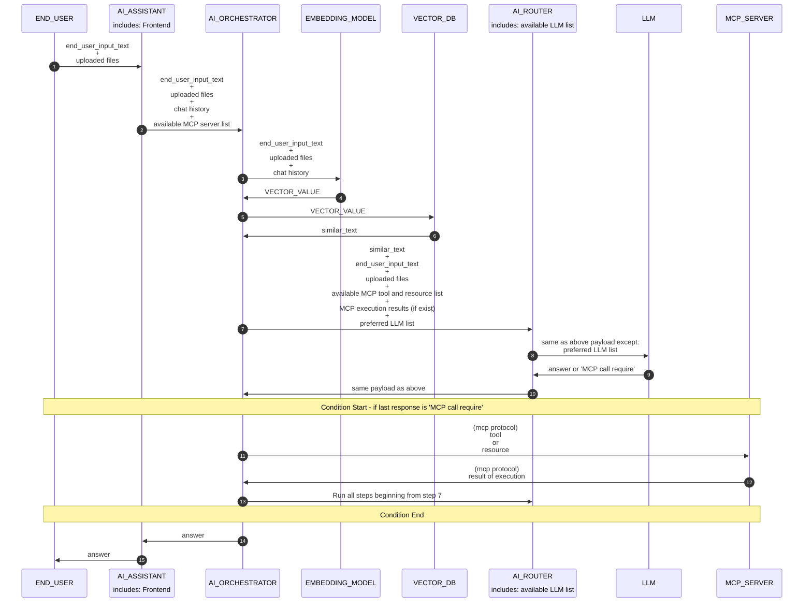

# AI

IIIIIIIIIIIIIIIIIIIIIIIIIIIIIIII

IIIIIIIIIIIIIIIIIIIIIIIIIIIIIIII

## 📌 yapay zeka (⟷ Artificial Intelligence ⟷ AI)

bir bilgisayarın, gerçek bir düşünebilen canlı gibi davranması (insan zekasını taklit edebilme) yeteneğidir. Bu terim kullanılırken arka planda bu işin nasıl yaptığı ile ilgilenilmez.

## 📌 Makine öğrenimi (⟷ machine learning ⟷ ML)

`AI` sanal bir beyindir. Fakat kendini eğitebilmesi konusu ayrıdır ve `ML` konusuna girer.

## 📌 yapay sinir ağı (⟷ YSA ⟷ Artificial neural network ⟷ ANN)

`YSA`, yapay bir zeka yapabilmek için bir mimaridir (yöntemdir). `AI` için, `YSA` kullanılmak zorunda değiliz. onun yerine eski oyunlarda olduğu gibi, araba yarışı tasarlayabilir ve diğer yarışçıların da akıllı davranabilmesini sağlayabiliriz.

## 📌 Bağlantısallık (Connectionism)

`YSA` yapısının felsefesi (teorisidir). sinir ağları arasındaki bağlantıları temsil eden teoridir.

## 📌 transformers

`YSA`'nın implementasyonunda kullanılan bir mimaridir. Input'ların paralel işlenmesini sağlayan mimaridir.

Paralel işleme yapmayan alternatif mimariler: `RNN` ve `LSTM`.

## 📌 Generative AI (⟷ Generative artificial intelligence ⟷ generative AI ⟷ GenAI ⟷ GAI ⟷ üretken yapay zeka)

yeni şeyleri kendi üretebilen zekalardır. bunu yapmak için yine geçmiş verilerden yararlanır.

## 📌 Dil modeli (⟷ Language Model ⟷ LM)

`dil`, burada input'u temsil eder. örnekler:
- `Türkçe` metin
- `İngilizce` metin
- `Java` kodu
- Özel formatlanmış audit log dosyası
- `regex`

`ai model`, matematiksel bir fonksiyon. input olarak `vector` alır, çıktı olarak yine `vector` verir.

`ai model`, kendi içindeki `Weight` sayısı (ve diğer bazı şeylerin) büyüklüğüne göre kategorize edilir. gerçek örnek değerler:

- `Small (or Edge)` - 1B to 4B
- `Medium (Desktop)` - 7B to 14B
- `Large`	- 70B - 100B+
- `Very Large (Frontier)` - 500B to 1T+

bu büyüklüklerin resmi bir sınıflandırması yoktur. 

büyük olanlar `LLM (⟷ Large Language Model)`, küçük olanlar `SLM (⟷ Small Language Model)` olarak sınıflandırılırlar. Medium olanlar, `MLM` olarak kısaltılmıyor çünkü `AI` dünyasında `MLM`'nin farklı anlamı var.

## 📌 markalar ve ürünler

| Company                                                  | Model / Ürün                             | Açıklama / Görevler                                                                                                             |
|----------------------------------------------------------|------------------------------------------|---------------------------------------------------------------------------------------------------------------------------------|
| `Meta`                                                   | `Llama (⟷ Large Language Model Meta AI)` | `ai model`                                                                                                                      |
| `Meta`                                                   | `Meta AI`                                | görevleri: `ai model` hariç herşey.                                                                                             |
| `OpenAI`                                                 | `GPT`                                    | `ai model` ailesinin ismi.                                                                                                      |
| `OpenAI`                                                 | `Luna`                                   | `ai model`. `GPT` ailesi altında. ucuz ve güçsüz.                                                                               |
| `OpenAI`                                                 | `Sol`                                    | `ai model`. `GPT` ailesi altında. pahalı ve güçlü.                                                                              |
| `OpenAI`                                                 | `Terra`                                  | `ai model`. `GPT` ailesi altında. dengeli                                                                                       |
| `OpenAI`                                                 | `OSS`                                    | `ai model`. `GPT` ailesi altında. açık kaynaklı.                                                                                |
| `OpenAI`                                                 | `Codex`                                  | eskiden sadece `ai model`'di. daha sonra tüm görevleri tek başına yapabiliyor duruma geldi. özel bir desktop uygulaması da var. |
| `OpenAI`                                                 | `ChatGPT`                                | görevleri: `ai model` hariç herşey.                                                                                             |
| `Google DeepMind`                                        | `Gemini`                                 | görevleri: tümü. sadece bulut hizmeti ile sunuluyor.                                                                            |
| `Google DeepMind`                                        | `Gemini Pro`                             | `ai model`.                                                                                                                     |
| `Google DeepMind`                                        | `Gemini Flash`                           | `ai model`.                                                                                                                     |
| `Google DeepMind`                                        | `Argon`                                  | `ai model`.                                                                                                                     |
| `Google DeepMind`                                        | `Gemma`                                  | `ai model`. local'e kurulabiliyor.                                                                                              |
| `Microsoft`                                              | `Copilot`                                | görevleri: `ai model` hariç herşey.                                                                                             |
| `Anthropic`                                              | `Haiku`                                  | ucuz ve güçsüz. `ai model`.                                                                                                     |
| `Anthropic`                                              | `Fable`                                  | `Sonnet`'ten güçsüz, ama `Haiku`'dan güçlü. `ai model`.                                                                         |
| `Anthropic`                                              | `Sonnet`                                 | dengeli. `ai model`.                                                                                                            |
| `Anthropic`                                              | `opus`                                   | pahalı ve güçlü. `ai model`.                                                                                                    |
| `Anthropic`                                              | `Claude`                                 | görevleri: `ai model` hariç herşey.                                                                                             |
| `Anthropic`                                              | `Claude Code`                            | sadece komut satırı `API`'si sunuyor. görevleri: `ai model` hariç herşey.                                                       |
| `Cognition`                                              | `SWE`                                    | ai model.                                                                                                                       |
| `Cognition`                                              | `Devin (⟷ old-name:Windsurf)`            | `VS Code` fork with `AI` customizations. görevleri: ai model hariç herşey.                                                      |
| `Anysphere` (group company: `SpaceXSI (⟷ old-name:xAI)`) | `Cursor`                                 | `VS Code` fork with `AI` customizations. görevleri: `ai model` hariç herşey.                                                    |
| `Alibaba`                                                | `Qwen`                                   | görevleri: tümü.                                                                                                                |
| `DeepSeek`                                               | `DeepSeek`                               | görevleri: tümü.                                                                                                                |
| `xAI`                                                    | `Grok`                                   | görevleri: tümü. `Twitter` firması, bunu son kullanıcılara (üyelerine) kullandırtıyor.                                          |

## 📌 ollama

açık kaynaklı bir yazılım.

her `LM` bir fonksiyon. bu fonksiyonları açık kaynaklı format olan `gguf` uzantılı dosyada tutarız. `ollama`'yı çalıştırdığımızda:
- `gguf` dosyasını okur,
- `HTTP` `API` açar ve bu fonksiyonun çağrılabilmesini sağlar. `OpenAI` `API`'si ile uyumlu `API` sunar ama ondan bağımsız kendi `API`'si de var.

bu tarz framework'lere `inference runtime (⟷ inference framework)` deniliyor.

## 📌 llama.cpp

`ollama`'nın arkaplanda kullandığı `C++` kütüphanesidir. Bu kütüphane ile programatik olarak `ollama`'nın yaptığı herşeyi yapabiliriz.

## 📌 logit

`ai model`'in her hesaplamada ürettiği bir sayısal değerdir.

istatistik bilimindeki `logistic unit` teriminden esinlenerek türetilen bir terimdir.

bir sonraki `token`'ın (kelime veya kelime grubunun) gelme olasığının puanı. bu an ne kadar yüksek ise, o kelimenin cümlenin devamına eklenme olasılığı o kadar fazladır.

örnek:

input: "Türkiye'nin başkenti neresidir?"

- next `token` - `logit`
- ankara - 99
- istanbul - 5
- izmir - 1

`ai model` bu puanı şöyle hesaplıyor: eğitim data'sında ilgili kelime (veya kelime grubunun) geçtiği cümlelerde, ankara ve istanbul ve izmir'in geçme oranı. Tabi bunun çok detayı var: noktalama işaretleri, kelimenin gerçek (kök) anlamaları, bağlaçlar, geçtiği paragraflar gibi birçok faktör de değerlendirilmektedir.

## 📌 reasoning vs sampling

`ai model`'in bu süreçleri yönetebilmesi için `inference runtime` şarttır.

`ai model` asıl cevabı dönmeden önce ara adımlar (hesaplamalar) yürütebilir. bunları tekrar kendine girdi olarak verip, sonuca ulaşabilir. bu sürece genel olarak `reasoning` denir.

`ai model` her ara hesaplama sonrası `logit` üretir. `sampling` aşamasında ise, `inference runtime`, bu `logit`'lerin arasından seçim yapma aşamasıdır. seçimleri yapmak için son kullanıcıdan aldığı veya `ai assistant`'tan alınan `temperature`, `top-k`, `top-p` gibi ayarlara (oranlara) göre hareket eder.

`inference runtime`, seçtiği `token`'ları `context`'e ekler ve gerekirse tekrar `ai model`'i çağırır.

## 📌 OpenRouter

`AI` için `API gateway`'dir. Birçok farklı `AI`'ya, ortak bir `API` üzerinden text ve görsel gibi medyalarla iletişim kurabilmemizi sağlar. Açık kaynaklı değildir. Ve sadece bulutta çalışır. local'e indirebileceğimiz bir yazılım değildir.

Bu yazılıma alternatif local'e kurulabilecek açık kaynaklı yazılımlar: `LiteLLM`, `Bifrost`.

`OpenAI` şirketinin kendi ürünleri için kullandığı `API` formatı piyasada sıkça tercih ediliyor. Bu sebeple `OpenRouter`, `OpenAI` ile çok uyumlu olacak şekilde tasarlanmış durumda.

## 📌 Open WebUI

`AI` için açık kaynaklı frontend yazılımıdır.

`ollama` ve `OpenAI` uyumlu `API`'lerin son kullanıcı ile kullanılabilmesini sağlar.

## 📌 Retrieval-Augmented Generation (⟷ RAG)

`türkçe`: `Bilgiyle Zenginleştirilmiş Yanıtlama`.

dış kaynaklardan bilgi toplayıp, `LLM`'e bunlarla birlikte soru sormayı temsil eden genel bir terim.

## 📌 mcp (⟷ Model Context Protocol)

açık kaynaklı protocol'dür. bir program, `TCP` üzerindeki haberleşme protocol'lerini kullanarak `API` sunarak hizmet sunar. `ai agent` external yerlerden bilgi toplamak icin bu `API`'lerden yararlanmir.

`MCP` şu protokoller üzerinden çalışabilir:
- `HTTP`
- `Stdio`

`MCP` API sunmayan yazılımlar için araya bir adaptör servisi gerekebilir. Böyle durumlar için 2 çözüm var:
- Bu servis local'de `ai orchestrator` ve/veya `ai agent` tarafından hard-coded yazılmış olabilir. Bu gibi durumlarda, bu servis `MCP` listesinde son kullanıcıya listelenmeyebilir. Çünkü zaten `ai orchestrator` ve/veya `ai agent`'ın gömülü yeteneğidir.
- bu adaptör servisi son kullanıcı tarafından local'den run edilir. `ai orchestrator` ve/veya `ai agent` bu servise `MCP` ile gider.

`MCP`'nn sunduğu her `API` fonksiyonu, 3 çeşit olabilir:

### 📌📌 tool

işlemin nerede execute edileceği belli, ama neyin execute edileceği tamamen MCP client'a kamış fonksiyonlardır.

örneğin; vereceğim `SQL`'i `Oracle DB`'de çalıştıran fonksiyon.

### 📌📌 resource

önceden belirlenmiş, sabit bir işlem yapabilmemizi sağlar.

örneğin; ID'sini vereceğim customer'ın bilgilerini döndüren fonksiyon.

### 📌📌 prompt

hazır prompt şablonları sunar.

## 📌 Github Copilot customizations

bu tanımlar sadece `github` `copilot` (`vscode` eklnetisi ve masaüstü application'ı) için geçerli terimler. bu terimler genel `AI` dünyasında farklı anlamlara gelebilir.

Terimlerin farklılıkları burada anlatılmış:

https://code.visualstudio.com/docs/agents/concepts/customization#_customization-options-at-a-glance

### 📌📌 Prompt

son kullanıcı chat'inden, komut gibi, manuel çağrılır. her `Prompt` bir senaryo dosyasıdır. örnek:

```markdown
---
description: Java kodunu review et
---

Seçili Java kodunu incele.

Bug, null-safety ve performans sorunlarını listele.

Minimal düzeltme öner.
```

bu dosya burada ise:

`.github/prompts/java-review.prompt.md`

bunu çağırmak için şu yazılmalıdır `prompt`'a:

```text
/java-review
```

### 📌📌 Skill

her `skill` birer text dosyasıdır. örnek:

`AI assistant` bu `skill` dosyalarının sadece isimlerini ve açıklama kısımlarını `AI`'a yollar. Artık `AI`, eğer son kullanıcı unit test yazdırmak isterse, tüm dosyası `AI assistant`'tan ister ve okur ve sonra bu dosyadaki kurallara dikkat ederek işlemlere devam eder.

```markdown
# Skill: Unit Test Yazma

## Açıklama
Verilen fonksiyon veya sınıf için sınır durumlarını (edge cases) da kapsayan, standartlara uygun unit test kodları üretir.

## Parametreler
- source_code (Metin, Zorunlu): Test yazılacak kaynak kod veya fonksiyon.
- framework (Metin, İsteğe Bağlı): Kullanılacak test kütüphanesi (örn: PyTest, Jest, JUnit).

## Beklenen Çıktı
Kaynak koda uygun, çalıştırılmaya hazır unit test dosyası içeriği.
```

### 📌📌 instruction

her chat'e mutlaka otomatik eklenir. ama bazı `instruction`'lar `regex` gibi tanımlarla ne zaman yollanacağı belirlenebilir.

örneğin; aşağıdaki `instruction` projemizde varsa, `java` dosyası chat'e eklenmişse, bu `instruction` mutlaka `AI`'a yollanır.

```markdown
---
applyTo: "*.java*"
---
- Java 21 kullan.
- Constructor injection kullan.
- Testlerde JUnit 5 kullan.
- Build komutu olarak `./mvnw` kullan.
```

### 📌📌 agent

`ai agent`'ın kullanacağı tüm config'leri barındırdığı için `agent` olarak isimlendirilmiştir. bu sebeple biraz terim karmaşası oluşabilir. `github`'ın `copilot` yazılımının 1 `ai agent`'i var sadece. o motor hiçbir şekilde değiştirilemiyor. Fakat `agent` ayarındaki config'ler ile manipüle edilebiliyor.

`agent`; `instruction`, `skill`, `mcp` servers, `prompt` gibi özellikleri 1 noktadan yönetip gruplamamızı sağlıyor. böylece 1 `agent` değişikliği yapıp, tüm bu özellikler arasından sadece bazıları aktif edebiliriz.

örnek olarak proje dizinimiz içinde şurada dosya oluşturursak:

`.github/agents/maven-java-maintainer.agent.md`

`vscode` `copilot` eklentisinde, `AI` chat penceresini açtığımız zaman bu profili (`agent`'ı) direk seçip `AI` ile chat'leşmeye başlayabiliriz.

`.github/agents/maven-java-maintainer.agent.md` dosyası içinde hangi tool'ların aktif olacağını vs yazabiliyoruz. Hatta bağımsız dosyalara referans verebiliyoruz. Böylece örneğin farklı `agent`'lar ortak `instruction`'lar kullanabilir.

## 📌 NLP (⟷ Natural Language Processing ⟷ Doğal Dil İşleme)

başka başlıkta anlatılmaktadır.

## 📌 derin öğrenme (⟷ deep learning ⟷ deep structured learning ⟷ hiyerarşik öğrenme)

makine öğrenmesinin bir alt dalıdır. çok katmanlı `AI`'ların kullanılmasıdır. örnek: araba kullanan `AI` yapacağız. level'lar:

- piksel
- köşeler (kenarlar)
- direksiyon, fren, pencere
- araba

## 📌 YSA modelinin boyutu

`ai model`in boyutu eğitilen datanın boyutu ile orantılı değil.

istediğimiz kadar küçük bir `ai model`i, istediğimiz kadar büyük bir data ile eğitebiliriz. `ai model` içinde her konu (domain) (örneğin fizik, matematik, Java) ayrı modül olarak durmaz. aynı ağırlıklar tüm konular için hesaplamaya girer. bu sebeple; küçük `ai model` kullanıp büyük eğitim datası verirsek, aynı ağırlıkları birçok farklı konu için kullanmış oluruz. böyle olursa, `ai model` detayları unutmaya başlar.

`ai model`in boyutu, `ai model` tasarlanırken, hard-coded `ai model` yazılımcısı tarafından set edilir.

`ai model`in boyutu ile eğitim verilecek data boyutnun doğru orantılı olmasında kesinlikle fayda var.

## 📌 AI assistant

son kullanıcı ile ilk temasa gecen yazılımdır. Bu sebeple `AI application` olarakta adlandırılırlar.

bu yazılımın kendisinde `LLM`'e benzer ufak ta olsa bir `AI` barındırmak zorunda değil. `AI` barındırıp barındırmayacağı, `AI assistant`'ın neleri desteklediğine bağlı değişir.

## 📌 AI Orchestrator vs AI agent

bu yazılımlar kendi içlerinde, `LLM`'e benzer ufak ta olsa bir `AI` barındırmak zorunda değildir.

`AI Orchestrator`, birçok `AI agent`'a yönlendirme yapabilmemizi sağlayan bir yazılımdır. Her `AI agent` kendi içinde bunları barındırır:

- gidebildiği `MCP` listesi
- gidebildiği `LLM` listesi
- isteği yerine etirene kadar ne kadar döngüsel işlem yapabileceğinin konfigürasyonları
- gibi

Her `AI agent`'ın scalability oranları farklı olabilir. Güvenlik ayarları farklı olabilir. Dolayısı ile bir sistemde birden fazla `AI agent` olabilir. Bunlara routing'i yapan yazılıma `AI Orchestrator` denir.

Hangi `AI agent`'a gideceğini;
- user anlık seçebilir
- veya `AI Orchestrator`, user'ın input'ta verdiği topic'e göre doğru `AI agent`'a yönlendirebilir.

## 📌 Cline vs Continue

bu 2 eklenti şu katmanların görevlerini içeriyor:
- `ai assistant`
- `ai orchestrator`
- `ai agent`

İkiside, `CLI`, `VS Code` extension ve `JetBrains` plugin olarak çalışıyor.

`Cline` ajan moduna ağırlık verirken, `Continue` ise, chat, `IDE`'de kod yazarken otomatik tamamlama gibi anlık feature'lere odaklanıyor.

`Continue` sunduğu özelliklerin çok hızlı sunması gerekli. Bu sebeple; `RAG` yapısını kendi otomatik sunuyor.

`Cline`'ın arkaplanda süreçleri işletebilmesi gerektiği için kendi desktop native app'leri de var.

## 📌 Vector DB

Aşağıdaki şemada `AI Orchestrator` ve `AI agent` aynı modülün içinde gösterilmiştir.



`Vector` `DB`'de query atarak, yakın konulardaki metin sonuçlarını bulmuş oluruz. Bu akışın `AI` ile alakası yok aslında. Ama `AI`'ya tüm dökümanlarımızı atarsak çok kaynak tüketir diye, sadece ilişkili data'ları atmamız önerilir.

`Vector` `DB`'ye sorgu attığımız zaman `vector` tipinde input veririz. return olarak `DB`'deki (`vector` uzayındaki), sorguladığımız `vector`'e en yakın `vector`'ü döner.

`Vector` `DB`'ye insert etmeden önce, insert edeceğimiz tüm data'yı `vector`'e çevirmeliyiz. Bu işlemi yaparken `DB`'den bağımsız çalışan `Embedding` `ai model`'den (kendisi de bir `AI`) yararlanmak zorundayız. `Vector` `DB`'ye query atarken mutlaka aynı `Embedding` `ai model`'den yararlanmak zorundayız.

### 📌📌 Embedding

`Dil`'i (`string`'i) sayısal veriye (`vector`'e) dönüştürme işlemidir.

`Embedding` `ai model` kelimelerin sözlük anlamlarını bilmiyor. Ama önceden eğitim almış. Bu sebeple; hangi kelimelerin, hangi kelimler ile ne kadar (hangi oranla) ilişkili olduğu bilgisine sahip. Böylece; input'ta `yazılım` kelimesi geçiyor ise, programlama ile ilgili tüm dökümanları döndürecektir.

## 📌 context

`context window`, `ai model`'in tek seferde yürütebildiği max `token` sayısı.

`context lenght`, o anda yürütülen `token` sayısı.

## 📌 short-term memory vs long-term memory

`short-term memory`, son kullanıcının chat history'sidir.

`long-term memory` ise birçok bilgisi kapsar:
- `RAG` ile çekilen dosyalar
- şirket içi dökümanlar
- son kullanıcının genel karakteristiğini tutan bilgiler. örnekler:
  - sürekli teknik terimler ile yazışmak istemesi.
  - developer olması.
  - her zaman tablo çıktılarını `HTML` output istemesi.
- fetch edilen web sayfaları için varsa cache'leri
- gibi.

## 📌 Bulanık mantık (⟷ bulanık eseme ⟷ puslu mantık ⟷ Fuzzy logic)

Bulanık mantığın temeli bulanık küme ve alt kümelere dayanır. Klasik yaklaşımda bir varlık ya kümenin elemanıdır (1) ya da değildir (0). bulanık mantık ile bir varlık üyelik derecesine göre birden fazla kümenin elemanı olabilir. üyelik derecesi 0-1 arasındadır. örnek olarak sıcaklık derecesi verilebilir. belirli bir seviyeden sonrasını sıcak belirli bir seviyeden sonrasını soğuk olarak ele alırsak; ılık sıcaklıkları tanımlayabiliriz.

## 📌 Sinaptik (⟷ Sinaptic)

`Sinaps (⟷ Synapse)` kelimesinde geliyor. `Sinaps`; `nöron (⟷ sinir hücresi ⟷ neuron)` denilen yapıdan, diğer nöronlara ya da kas ya da salgı bezleri gibi nöron olmayan hücrelere mesaj iletmesine olanak tanıyan özelleşmiş bağlantı noktalarıdır.

## 📌 YSA yapısı

Giriş data'sı, her `hücre (⟷ node ⟷ düğüm)` denilen yapıya geldiğinde `ağırlık (⟷ W ⟷ Weight)` değeri ile çarpılır. Her girişten gelen aynı derecede önemsenmeyeceği için bu çarpım işlemi yapılır.

## 📌 YSA Katmanlar (⟷ Layers)

`YSA`'nın ilk girdi aldığı hücreler ve son çıkışa giden hücreler arasında da hücreler olabilir. aradaki katmanlara (ilk ve son katmanlar hariç) `gizli katmanlar (⟷ ara katmanlar)` denir. Dolayısı ile gizli katmanlı olan bir ağ, en az 3 katmandan oluşuyordur.

çok katmanlı `YSA`, en az 2 katmandan oluşur.

bir `YSA`, en az 1 katmandan oluşabilir.

## 📌 Ağın Eğitilmesi

`YSA`'nın eğitilmesi için doğru olarak bilinen giriş ve çıkış değerlerinin elimizde olması gerekir. `YSA`'ya girdiler verilir ve `YSA`'nın verdiği çıktı ile gerçek çıktı karşılaştırılır. İşte bu hata payına göre, `ağırlık` değerleri her işlem sonrası değiştirilir. Bu eğitim şekline `geri besleme (⟷ geri yayılım ⟷ backpropagation)` denir. Birçok farklı `eğitim (⟷ training)` şekli düşünülebilir.

Ağa ilk `W` değerleri ya rastgele yada belli referanslara dayanılarak ta atanabilir.

Test süreçlerinde `YSA`'nın eğitilmemesi gerekmektedir.

## 📌 Hopfield Ağları (Hopfield Net)

Aşağıdaki kurallara uyan sinir ağlarına verilen özel isimdir. Bunun gibi birçok ağ mevcuttur.

- Tüm hücrelerde sadece 1 ve 0 değerleri giriş çıkışlarda olmalıdır

- Nöronlara gelen ağırlıklar aktivasyon fonksiyonuna gelmeden hemen önce toplanırlar

- Nöronlarda aktivasyon fonksiyonu olmalı ve eşik değeri kullanılmalıdır

Katman kavramı yoktur. Tüm hücreler diğer tüm hücrelere bağlıdır. Yani aslında tek katmanlıdır diyebiliriz. Böylece tüm girişler (hücreler) aynı zamanda çıkışları verecektir. `n` girişli ve `n` çıkışlıdır. Her bir hücre çıkışı, bir sonraki iterasyonda diğer tüm hücrelerin girişine etki etmektedir.

## 📌 iterasyon vs epoch

`epoch`'un `Türkçe` kelime anlamı: devir, çağ, dönem'dir.

iterasyon; `YSA`'nın bir kere input alıp, bir kere çıktı vermesine kadar olan süreçtir.

`YSA`'lar eğitilirken bir eğitim seti (giriş ve çıkış seti) olmaktadır. Bu tüm set `YSA`'ya verilir ve `YSA` kendini sonuçlara göre eğitir. Tüm eğitim seti dolaşıldığında bir epoch süresi geçmiş sayılır. `YSA` eğitiminde bazen epoch sayısını (aynı eğitim seti için) birçok kere geçmek gerekebilir.
