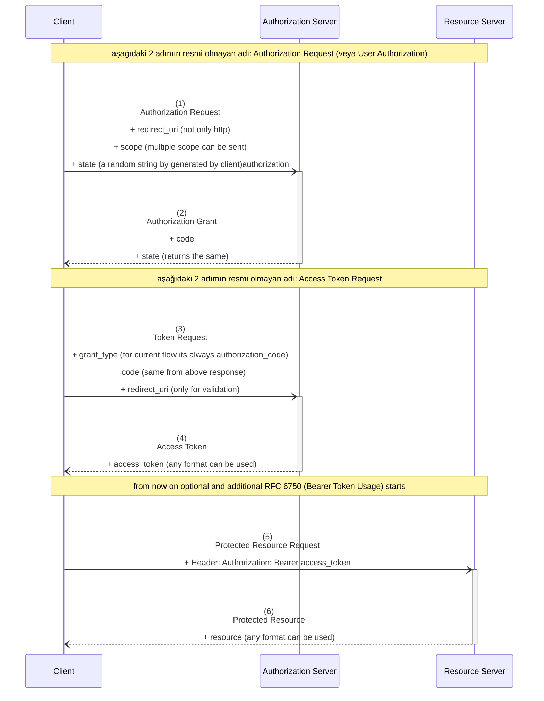
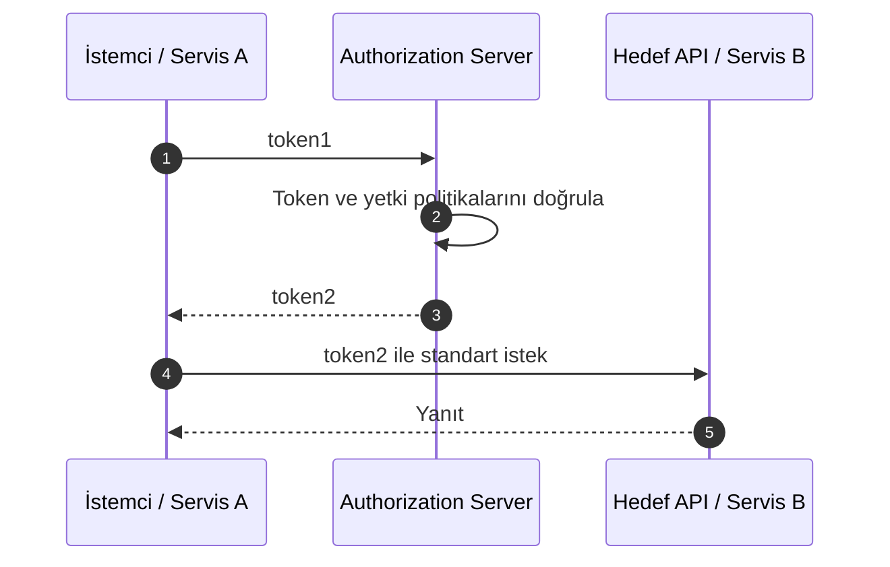

# SECURITY OAUTH

IIIIIIIIIIIIIIIIIIIIIIIIIIIIIIII

IIIIIIIIIIIIIIIIIIIIIIIIIIIIIIII

`otantik (⟷ authentic)` terimi, `orjinal` anlamına gelir. `authentication` buradan türemiştir. `authentication`; bir şeyin `otantik` olup olmadığını onaylamak için kullanılan fiildir.

| method                                | kısaltma |
|---------------------------------------|----------|
| `authentication (⟷ kimlik doğrulama)` | `authN`  |
| `authorization (⟷ yetkilendirme)`     | `authZ`  |

## 📌 Auth0

`Okla` firmasının, sadece bulut olarak sunulan, `Keycloak` alternatifi ürününün ismi.

## 📌 Server terms

`auth server`, `authentication` ve/veya `authorization` ile ilgili herhangi bir işlem yapabilen server'dır.

`oauth` `2.0` dünyasında sadece `authorization` server var. çünkü kendisi sadece `authorization` protokocol'ü.

`identity provider (⟷ IdP)` `authentication` sürecini sunan ve üçüncü parti clinet'ara da bunu sunabilen server'lardır.

## 📌 örnek

`authentication` örneği:

`Twitter ile Giriş Yap` dedi son kullanıcı. `twitter` basic user info'sunu 3rd party siteye verdi. Ama `twitter`'da user adına hiçbir işlem yapamaz bu 3rd party site. 

`authorization` örneği:

Son kullanıcı 3rd party siteye `Tweet atma izni ver` dedi.

## 📌 protocols

| protocol name and version       | amaç                             | provider'a önceden register olmak şart mı | geriye uyumlu         |
|---------------------------------|----------------------------------|-------------------------------------------|-----------------------|
| `OpenID` `1.0` ve `2.0`         | `authentication`                 | hayır                                     | zaten ilk versionlar. |
| `Oauth` `1.0` ve `1.1`          | `authorization`                  | evet                                      | zaten ilk versionlar. |
| `Oauth` `2.0`                   | `authorization`                  | evet                                      | hayır.                |
| `OpenID Connect (⟷ OIDC)` `1.0` | `Oauth` `2.0` + `authentication` | evet                                      | zaten ilk versionlar. |

## 📌 openid connect vs oauth 2.0 detay

`openid connect`'te, `oauth` `2.0`'ye ek sadece ek akışlar var.

- `Scope`: `OpenID Connect` akışında `openid` scope'u yazması gerekir.

- ID Token: `OpenID Connect` akışında, `access token` ile birlikte bir `id_token` döndürülür. `id_token` bir `JWT`'dir. burada user bilgileri vardır.

- ek birçok özellik daha var.

## 📌 oauth passthrough (oauth pass-through)

`Grafana` uygulamasının bunu desteklediğini Readme'de görebiliriz:

https://github.com/grafana/grafana-infinity-datasource

`oauth` `2.0` standartında olmayan bir terimdir. Bu sebeple her yazılım kendi terimini kullanabiliyor.

`Grafana` data-source'den data çekerken kullanacağı `access token`'ı, 2 farklı yöntemle elde eder:

- `Oauth passthrough`

  `grafana`'ya login olan kullanıcı `Login with Azure` gibi bir seçenek seçerse, o kullanıcının `azure` için kullandığı `access token`'ını data-source'a aynen yollar.

- `grafana` admin'i, `grafana`'ya `authentication` ve `authorization` bilgilerini kaydeder ve bunların hangi yöntemler (protocol'ler) ile çalışacağını belirtir. daha sonra bu bilgiler, data-source'tan data çekme işlemi sırasında kullanır.

## 📌 scope

bu kavram tüm `authorization` mekanizmalarında var.

`scope`'lar, client uygulamasının rolleri olarak düşünülmelidir. login olan son kullanıcının

- `Google`'daki role'ü, `Google` `Drive` dosyalarına erişmek olabilir,
- fakat sadece `email` `scope`'una sahip bir uygulama sadece `gmail`'e erişebilir.

### 📌📌 predefined scopes

- `OIDC` `1.0` sürümünde, `scope`'larda `OpenID` olmak zorundadır.

- `OIDC` `1.0` sürümünde, `scope`'larda istenirse `offline_access` olabilir. `offline_access` `scope`'u varsa, son kullanıcı web tarayıcısını (uygulamasını) kapatsa dahi, arka planda `access token` ile user info bilgilerine erişebileceği anlamına gelir.

  Tam olarak hangi bilgilerin user info olduğu standartlarda yazmamaktadır. fakat önceden ayrılmış field'lar vardır. `kaynak: https://openid.net/specs/openid-connect-core-1_0.html title: "5.1. Standard Claims".`

## 📌 Oauth 2.0

### 📌📌 rollere bazı örnekler

|                        | banka uygulaması                     | Login to `google.com` via `Facebook.com` | `Github` `MCP` server ve `AI agent` mimarisinde                                    |
|------------------------|--------------------------------------|------------------------------------------|------------------------------------------------------------------------------------|
| `Authorization Server` | `user-microservice`                  | `Facebook.com`                           | `Github` server                                                                    |
| `Resource server`      | `payment-history-microservice`       | `Facebook.com`                           | `MCP` server (which is `Github` server)                                            |
| `Resource owner`       | banka müşterisi                      | facebook kullanıcısı                     | `ai agent`'a input yazan son kullanıcı                                             |
| `Resource`             | kullanıcının card payment history'si | user's `facebook` post and comments      | kullanıcının `github`'daki kod repository'leri, `PR`'ları, issue'lara comment'leri |
| `Client`               | mobil app of bank, `ATM`             | `amazon.com`                             | `ai agent` (which includes the `mcp` client)                                       |

`RFC`'de geçmesede `Authorization Server`'a `issuer` deniliyor piyasada.

## 📌📌 simülasyon

<https://www.oauth.com/playground/index.html>

### 📌📌 e2e süreç alternatifleri

`Oauth` `2.0`'da, 4 farklı şekilde `access token`'ı client elde edebiliyor.

Fakat `oauth` `2.0` esneklik sağlamış durumda. Bu süreçleri baştan sonra bir eklenti (`RFC`) değiştirebiliyor. Sadece bazı iskelet kurlalara uymak zorundalar eğer `oauth` `2.0` ile uyumlu olacaklarsa. bütün flow'lar, 1 adımlı ve ya 2 adımlı olabilir. Bazı akışlar polling gibi işlemlerde yapabilir.

`Oauth` `2.0` `RFC`'sinde, `Refresh token` isimli bir flow var. bu flow `access token`'ı yenilemek için. ilk almak için değil.

#### 📌📌📌 (core oauth RFC) 1 - Authorization Code

client'ın, `Authorization Server`'dan (provider'dan) bir `client_id` alması şarttır.  `client_secret` opsiyoneldir.

##### 📌📌📌📌 Proof Key for Code Exchange (PKCE)

Yukarıdaki redirect yapılırken araya biri girmiş olabilir. Bu sebeple opsiyonel ve ek olarak `RFC 7636` çıktı. `RFC`'ye göre şu şekilde ekstra parametre ekleyerek işliyor:

1inci adıma client şunları ekliyor:
- `code_challenge` = `SHA 256`(`code verifier`)
- `code_challenge_method` (hardcoded: `S256`)

3üncü adımda:
- `code_verifier`

Böylece sunucu bunları onaylayabilir.

`SHA 256` yerine `plain` yollanabilir yazıyor `RFC`'de. Bu tamamen `SHA 256` yapamayan client'lar için geçerli ve kısmen faydası olur.

#### 📌📌📌 (core oauth RFC) 2 - implicit

- Sadece 1 adımda direk client'a `access token` döndürülüyor.
- yine son kullanıcı redirect ediliyor. Fakat client 2 kere provider'a gitmiyor.

#### 📌📌📌 (core oauth RFC) 3 - Resource Owner Password Credentials Grant

- user kendi şifre'sini direk client'a veriyor.
- artık client, bu şifre ile 1 adımda `authorization server`'dan `access token` alır. bu `access token`'ı nasıl alacağı da tanımlanmıştır core `oauth` `2.0` `RFC`'sinde.

#### 📌📌📌 (core oauth RFC) 4 - client credentials

1 adım var sadece.

client son kullanıcıdan hiçbir bilgi almadan kendi bilgileri ile `access token` alır.

#### 📌📌📌 (RFC 7523) JSON Web Token (JWT) Profile for OAuth 2.0

1 adım var sadece.

`client credentials` flow'u ile aynı amaçtadır ve aşırı benzerdir. Tek farkı: Secret olarak kendi şifrelediği `JWT` ile yapar. bu `JWT` içinde user bilgisi de olabilir. Bu `JWT`'yi dış kaynaktan da çekebilir öncesinde.

#### 📌📌📌 (RFC 7522) SAML 2.0 Profile for OAuth 2.0

1 adım var sadece.

`client credentials` flow'u ile aynı amaçtadır ve aşırı benzerdir. Tek farkı: Secret olarak kendi şifrelediği `SAML` ile yapar. bu `SAML` içinde user bilgisi de olabilir. 

#### 📌📌📌 (RFC 8693) OAuth 2.0 Token Exchange

`impersonation` kelime anlamı: taklit etme, kimliğe bürünme.

Bu `RFC`, `impersonation` veya `delegation` işlemi sunar.

`U1` user'ı, `U2` user'ı yerine, `P` yazılımında işlem yapar. 2 farklı mod sunar. 2 moddan 1'i seçilmelidir.
- `impersonation` modunda olursa, `P` platformunda yapılan her işlemin kaydında `U2` yazar. (Opsiyonel olarak `U1`'in user bilgisi, `P`'ye token ile verilebilir)
- delegation modunda olursa, `P` platformunda yapılan her işlemin kaydında `U1` yazar.

Her 2 modda da, yekiler kısmı devredilebilir.

`RFC` `8693` şu konularda kural içermiyor:
- `Token1`'in nasıl elde edileceği.
- `Token2` ile Client'ın Servis `B`'ye nasıl istek atacağı.

Buna uyan gerçek mimari örnekleri:
- `Grafana` bir datayı çekmek için, user'ın token'ını ile başka token almalı.
- `MCP` server bir datayı çekmek için, user'ın token'ını ile başka token almalı.

#### 📌📌📌 (RFC 8628) OAuth 2.0 Device Authorization Grant

farklı cihazdan onay alınan ve polling yöntemi ile kontrol ettiren akıştır.